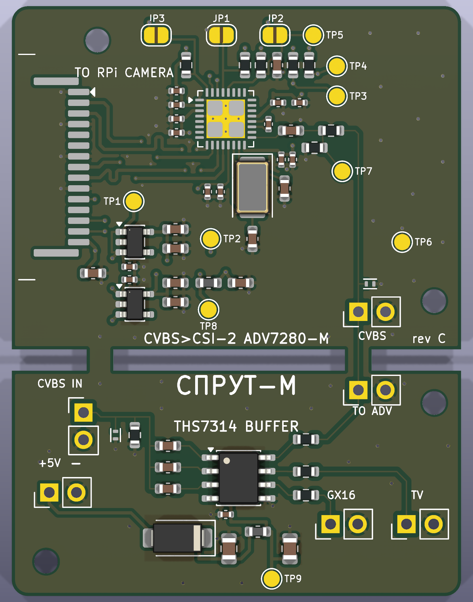

# ADV7280M-CSI2 — CVBS → MIPI CSI-2 декодер для Raspberry Pi 4

Плата на Analog Devices **ADV7280BCPZ-M** (LFCSP-32; в rev A/B — ADV7280WBCPZ-M, вывод в вывод то же самое): композитный видеосигнал (PAL/NTSC/SECAM)
преобразуется в поток MIPI CSI-2 (1 лента + клок) и подаётся на разъём камеры Raspberry Pi 4.
На той же плате — **буфер THS7314**: один вход CVBS раздаётся на декодер и два монитора.

**Ревизия C — под кейс СПРУТ-2** (`sprut.korpus`): заменяет связку «разветвитель 1→2 + USB-граббер STK1160».
Секция буфера **отламывается** (паз 2 мм и две перемычки): декодер можно поставить прямо у Raspberry Pi (короткий шлейф CSI),
буфер — у панели BNC; после отлома половины соединяются коаксиальным кабелем, припаянным к площадкам **J8 «TO ADV»** (буфер)
и **J2 «CVBS»** (декодер). Пока плата целая, видео идёт по дорожке через перемычку и кабель не нужен.
Разъёмов на плате нет: все провода и кабели **паяются** в площадки с отверстиями — вход с BNC панели (J5), выходы на AV телевизора (J6 «TV») и внешний монитор (J7 «GX16»),
5 В от DC-DC 5 В кейса (J4). Ревизия B (RCA-вход, штырьки, клемма) — в истории git.
Работает со штатным overlay ядра Raspberry Pi без правок:

```
dtoverlay=adv728x-m,adv7280m=1
```

Проект в KiCad 10 (`hw/`; генераторы и файлы ревизии B были под KiCad 9), плата 4 слоя **42 × 55 мм** под стек JLCPCB JLC04161H-7628.
ERC и DRC (с проверкой соответствия схеме) — 0 ошибок, 0 предупреждений. Все решения и допущения по этапам — в `docs/assumptions.md`,
исходные требования и выжимка из документации — в `docs/requirements.md`.



## Состав репозитория

| Путь | Что |
|---|---|
| `hw/adv7280m-csi2.kicad_pro / .kicad_sch / .kicad_pcb` | проект KiCad 10 |
| `hw/lib/` | символы ADV7280 (имя символа ADV7280WBCPZ-M, подходит и для BCPZ-M) и THS7314, символы питания, посадочные места FFC (Amphenol SFW15R-1STE1LF), X1SON, QFN-32 для U1 с пастой под термо-via (`…_Paste4`) (RCA PSG01546 остался от rev B, не используется) |
| `hw/adv7280m-csi2.kicad_dru` | своё правило DRC: заливка земли в 0,4 мм от видеоцепей (75 Ω) |
| `docs/routing-rules.md` | правила разводки, расчёт импедансов (`tools/zsolve.py`) и аудит платы по ним |
| `docs/mech/` | контур платы и вид сверху (DXF), STEP с компонентами, размеры для корпуса (`enclosure-dims.md`) |
| `docs/schematic.pdf`, `docs/bom.csv` | схема и BOM с кодами LCSC |
| `docs/render-top.png`, `docs/render-bottom.png`, `docs/layer-*.png` | 3D-рендеры и медь по слоям |
| `docs/datasheets/`, `docs/ref/` | даташит ADV7280 Rev. A, UG-637 Rev. A, AN-1260, THS7314 (SLOS513A), схемы Pi 4 и Camera Module v2.1, overlay/драйвер из ядра Pi |
| `fab/adv7280m-csi2-gerber.zip` | Gerber (RS-274X, Protel-расширения) + Excellon drill + gbrjob со стеком |
| `fab/BOM_JLCPCB.csv`, `fab/CPL_JLCPCB.csv` | BOM и позиции в формате JLCPCB (только то, что собирает JLCPCB) |
| `tools/` | генераторы: `gen_lib.py` → `gen_fp.py` → `gen_sch.py` → `gen_pcb.py` → `route_pcb.py` → `write_pro.py`; `check_nets.py` проверяет нетлист; `fab.sh` делает Gerber/BOM/CPL, `render.sh` — картинки |

Пересборка с нуля (Linux; `gen_pcb.py` и `route_pcb.py` нужен Python с модулем `pcbnew` из KiCad):

```
python3 tools/gen_lib.py && python3 tools/gen_fp.py && python3 tools/gen_sch.py && python3 tools/check_nets.py
cd hw && kicad-cli sch export netlist --format kicadxml -o adv7280m-csi2.xml adv7280m-csi2.kicad_sch && cd ..
python3 tools/gen_pcb.py && python3 tools/route_pcb.py && python3 tools/write_pro.py
sh tools/fab.sh          # Gerber, drill, BOM/CPL JLCPCB, schematic.pdf, bom.csv
```

На Windows с KiCad 10 скрипты сами находят библиотеки в `C:/Program Files/KiCad/10.0/share/kicad`;
`gen_pcb.py`/`route_pcb.py` запускать через `"C:\Program Files\KiCad\10.0\bin\python.exe"`, для `check_nets.py` и `fab.sh`
задать `KICAD_CLI` (путь к `kicad-cli.exe`), для `fab.sh` ещё `PY=python`.

## Схема в двух словах

* **Вход декодера**: канал 1 буфера (через 75 Ω R9) → 22 Ω последовательно, 51 Ω на землю (нагрузка 73 Ω, делитель 0,7) → 100 нФ → AIN1.
* **Питание**: 3,3 В с пина 15 разъёма камеры. Два LDO AP2112K-1.8: U2 → DVDD+MVDD, U3 → AVDD, PVDD через феррит.
  У каждого вывода питания чипа 100 нФ + 10 нФ.
* **Кварц** 28.63636 МГц (YXC 5032, CL 20 пФ), нагрузочные 27 пФ.
* **MIPI**: D0P/D0N → пины 3/2 разъёма, CLKP/CLKN → пины 9/8; лента 1 не используется. Дифпары 100 Ω слабо связанные
  (0,30/0,45 мм, синфазный ≈ 29 Ω — «2 × 50 Ω» по UG-637), длины выровнены: в паре 0,00 мм, между парами 0,20 мм (≈ 1 пс).
* **I²C**: SDA/SCL → пины 14/13, подтяжки 4,7 кОм (параллельно подтяжкам Pi). ALSB = 1 → 7-битный адрес **0x21**
  (8-битный 0x42 write / 0x43 read) — ровно то, что ждёт overlay.
* **RESET**: 10 кОм + 4,7 мкФ (τ ≈ 47 мс, низкий уровень ≥ 13 мс), **PWRDWN**: 10 кОм к 3,3 В — чип запускается сам, без участия Pi.

### Буфер THS7314

* **Вход** J5 (площадки под коаксиал у левой кромки, 1 = сигнал (квадратная), 2 = GND) → терминация 75 Ω, ESD → 3 × 100 нФ →
  три канала THS7314 (усиление 6 дБ, ФНЧ 8,5 МГц, sync-tip clamp).
* **Выходы** с 75 Ω последовательно (на нагрузке 75 Ω уровень 1 : 1): канал 1 → вход декодера (постоянно, без перемычек),
  канал 2 → J6 «TV», канал 3 → J7 «GX16» (площадки под коаксиал внизу справа, 1 = сигнал, 2 = GND).
* **Питание** J4 (площадки под провода внизу слева, 1 = +5 В — левая, у метки «+5V», 2 = GND) от DC-DC 5 В кейса
  → диод SS14 (защита от переполюсовки) → 22 мкФ → феррит → 10 мкФ + 100 нФ. THS7314 работает от 3 до 5 В, LDO не нужен;
  потребление ≈ 17 мА. Тестовая точка TP9.
* **Декодер питается от Pi** (3,3 В по шлейфу камеры), J4 его не питает. Если Pi выключена, буфер всё равно раздаёт видео на ТВ и монитор.

### Подключение в кейсе СПРУТ-2

| Разъём на плате | Куда | Кабель |
|---|---|---|
| J5 «CVBS IN» (пайка) | BNC на панели (вход видео с приёмника / балуна) | коаксиальный 75 Ω (RG-179/RG-316), длина по месту; центральная жила → пин 1, оплётка → пин 2 |
| J6 «TV» (пайка) | AV-вход телевизора EPLUTUS в крышке | коаксиальный 75 Ω, на конце RCA/джек по разъёму ТВ |
| J7 «GX16» (пайка) | разъём GX16 «монитор» на панели | коаксиальный 75 Ω до GX16 |
| J4 «+5V» (пайка) | выход DC-DC 5 В 5 А (тот же модуль, что питает Pi) | 2 провода 0,2–0,35 мм² |
| J1 (FFC) | разъём камеры Pi 4 | шлейф камеры 15 конт. 1,0 мм: если плата целая — **30–50 см** (плата под нишей модулей, Pi под решёткой справа); если декодер отломан и стоит у Pi — 5–15 см |
| J8 «TO ADV» → J2 «CVBS» (площадки) | только если секции разделены | коаксиальный 75 Ω (RG-179/RG-316) любой разумной длины; центральная жила → квадратная площадка 1, оплётка → площадка 2 |

Плата заменяет в кейсе разветвитель видео 1→2 и граббер STK1160 (USB-порт Pi освобождается). Видео с платы в Pi идёт по
CSI, `/dev/video0` даёт драйвер `adv7180` + `unicam`. В `ustreamer.service` для этой платы формат UYVY, стандарт PAL ставится
через `v4l2-ctl --set-standard=PAL` (как сейчас для STK1160), регулировки яркости/контраста у `adv7180` свои — сверить `v4l2-ctl --list-ctrls`.

### Перемычки (паяльные, по умолчанию разомкнуты)

| | Замкнуть, если |
|---|---|
| JP1 `ALSB>GND` | нужен адрес 0x20; тогда в config.txt `dtoverlay=adv728x-m,adv7280m=1,addr=0x20` |
| JP2 `CAM_GPIO>RST` | хотите сбрасывать чип линией CAM_GPIO (пин 11 разъёма). Штатный overlay эту линию не включает, поэтому по умолчанию разомкнуто |
| JP3 `CAM_GPIO>PWRDWN` | хотите усыплять чип линией CAM_GPIO. То же самое: только со своим overlay, где включён регулятор `cam1_reg` |

### Тестовые точки

TP1 3V3 · TP2 1V8D · TP8 1V8A · TP3 SDA · TP4 SCL · TP5 RESET · TP6 GND · TP7 CVBS после терминации (сюда должно приходить ≈0,7 В p-p при 1 В на входе) · TP9 питание THS7314 (≈4,6 В).

## Подключение к Raspberry Pi 4

Пошаговый запуск новой платы — осмотр, прозвонка, проверка буфера без Pi, тестовая таблица, видео, ustreamer и что делать,
если не работает, — в **[docs/bring-up.md](docs/bring-up.md)**. Ниже — кратко.

1. Стандартный 15-жильный шлейф камеры Pi (тот же, что у Camera Module). На плате разъём такой же, как на модуле камеры:
   контакты шлейфа **к плате**, синяя сторона к защёлке. Пин 1 (GND) помечен треугольником, он у верхнего края.
   На Pi 4: контакты шлейфа в сторону HDMI, синяя сторона к Ethernet/USB.
2. Перед первым включением прозвоните: пин 15 шлейфа (3,3 В) ↔ TP1, пин 1 ↔ TP6 (GND).
3. В `/boot/firmware/config.txt` (на старых образах `/boot/config.txt`):

   ```
   camera_auto_detect=0
   dtoverlay=adv728x-m,adv7280m=1
   ```

   Строка `camera_auto_detect=0` отключает автопоиск камер Pi, который иначе может занять I²C и CSI.
4. Перезагрузка и проверка:

   ```
   dmesg | grep -i adv7180          # ожидается: adv7180 10-0021: chip found @ 0x21 ... (шина i2c-10 на Pi 4)
   v4l2-ctl --list-devices          # unicam -> /dev/video0
   v4l2-ctl -d /dev/video0 --get-detected-standard
   v4l2-ctl -d /dev/video0 --set-standard=PAL     # или NTSC
   ```

   Драйвер `adv7180` работает как V4L2 subdevice за `bcm2835-unicam` (в overlay по умолчанию legacy-режим,
   Media Controller выключен). Формат на выходе — 8-битный YUV 4:2:2 (UYVY). По умолчанию драйвер отдаёт полукадры 720×288 (PAL) / 720×240 (NTSC),
   50/60 в секунду (`Field: Alternate`); с `field=none` включается встроенный деинтерлейсер ADV7280-M и кадры
   становятся 720×576 / 720×480 прогрессивными (см. docs/bring-up.md, шаги 8–9).
5. Захват:

   ```
   v4l2-ctl -d /dev/video0 --set-fmt-video=width=720,height=576,pixelformat=UYVY,field=none --stream-mmap --stream-count=100 --stream-to=out.uyvy
   ffmpeg -f v4l2 -input_format uyvy422 -video_size 720x576 -i /dev/video0 -c:v libx264 -preset veryfast out.mkv
   ```

### Вывод на ПК как «карта захвата»

Плата отдаёт только MIPI CSI-2, напрямую к ПК её не подключить. Варианты через Pi 4:

* **UVC-вебкамера по USB-C.** Pi 4 умеет режим USB-устройства: `dtoverlay=dwc2` в config.txt, модуль `libcomposite`,
  и `uvc-gadget` (github.com/raspberrypi/uvc-gadget или kbingham/uvc-gadget с источником V4L2 `/dev/video0`).
  ПК видит обычную вебкамеру 720×576. Не проверялось на этой плате, но это штатный механизм Pi.
* **Поток по сети**: `ffmpeg -f v4l2 -i /dev/video0 ... -f mpegts udp://ПК:5000` или GStreamer/RTSP; на ПК VLC/OBS/ffplay.

## Заказ и сборка на JLCPCB

1. Плата: загрузить `fab/adv7280m-csi2-gerber.zip`. Параметры на jlcpcb.com/quote: FR-4, 4 слоя, 5 шт., Different Design 1,
   Delivery Format **Single PCB**, 1,6 мм, ENIG, Outer 1 oz / Inner 0,5 oz, **Specify Stackup: Yes → JLC04161H-7628**
   (под него рассчитаны пары 100 Ω дифф — 0,30/0,45 мм и видео 75 Ω — 0,13 мм с зазором 0,4 до заливки; Impedance Control —
   «No requirement», ширины уже посчитаны), Via Covering **Plugged** (Tented для 4 слоёв недоступен),
   Min via hole size **0.3mm/(0.4/0.45mm)** — стандартная бесплатная опция: все via на плате 0,5/0,3 мм (A6-21);
   Confirm Production File: Yes; остальное по умолчанию. Опции панелизации/V-cut не нужны.
   Via в термопаде U1 (5 шт., 0,5/0,3 мм) стоят вне окон пасты (п. 4); «Epoxy filled & capped» — платная опция, не обязательна.
2. Сборка: Economic (SMT), верхняя сторона. Загрузить `fab/BOM_JLCPCB.csv` и `fab/CPL_JLCPCB.csv`.
   Для одиночной платы в Economic технологические поля и реперные метки не нужны; если JLCPCB попросит (Standard-сборка
   или замечание DFM из-за разъёма J1 на кромке), согласиться на поля 5 мм и реперы, которые они добавят на панель.
   **В предпросмотре обязательно сверить ориентацию** полярных деталей: U2/U3 (SOT-23-5, пин 1 у метки-треугольника),
   D3 (ESD, двунаправленный — ориентация не важна), J1 (FFC: контакты к краю платы, пин 1 сверху), Y1 (кварц — не важна),
   U5 (SOIC-8, пин 1 слева сверху, у метки), D2 (SS14: катодная полоска к C28, т. е. вправо).
   JLCPCB иногда поворачивает корпуса относительно данных KiCad; в предпросмотре это видно по картинке детали.
3. Чип **U1 ADV7280BCPZ-M (LCSC C662255)** собирает JLCPCB вместе с остальным SMD. Позиция Extended и дорогая (≈ 24 $ за штуку),
   на складе LCSC мало (8 шт. на 2026-10-15) — проверить наличие в редакторе BOM при заказе; если нет, JLCPCB предложит предзаказ.
   В предпросмотре сверить ориентацию: точка-ключ корпуса (пин 1) — слева сверху, у метки-треугольника на шелкографии.
   Разъёмов на плате нет: J2, J4–J8 — металлизированные отверстия Ø 1,0 мм, провода и коаксиальные кабели припаиваются к ним
   (центральная жила → квадратная площадка 1, оплётка → 2; у питания +5 В → 1). Провода у платы закрепить стяжкой или клеем.
   Перемычки/тестовые точки — это просто площадки.
   THT-сборку у JLCPCB не заказываем — это дешевле, чем доплата за выводной монтаж.
4. Трафарет отдельно не нужен: при сборке JLCPCB использует свой. Паста на термопад U1 — 4 окна 1,35 × 1,35 мм (≈ 56 %,
   рекомендация JLCPCB для QFN 50–75 %); 5 via 0,5/0,3 мм стоят в промежутке без пасты, отверстия ≥ 0,2 мм от окон
   (посадочное место `…_Paste4` в `hw/lib`).
5. На опытной плате проверить кварц: запуск после подачи питания и частоту (≈ 28,63636 МГц ± 50 ppm, например по
   стабильности захвата видео или частотомером на XTALP через щуп 10×). C2/C3 = 27 пФ при расчётных 30 пФ (CL 20 пФ,
   AN-1260) дают сдвиг вверх на десятки ppm; если частота выше допуска — поставить 30–33 пФ.

Extended-позиции (по 3 $ за наименование): ADV7280, LDO, кварц, 27 пФ, ESD-диод, FFC-разъём, THS7314. Остальное — Basic (1 мкФ 0402 C52923 у входов LDO — по известным данным тоже Basic, сверить в редакторе BOM). Всего 23 строки BOM, 50 деталей на сборку.

## Известные особенности

* В каждой дифпаре MIPI обе линии уходят на нижний слой и возвращаются (по два via 0,5/0,3 мм): N — перекрёсток под P
  (порядок P/N на разъёме Pi обратен порядку выводов чипа, без перекрёстка это не разводится), P — прямой переход, чтобы
  в паре были одинаковые задержка и неоднородности. Под всеми участками на нижнем слое — земля (In2), у каждого
  via — GND-via (см. `docs/routing-rules.md` и `docs/assumptions.md`, A6-13).
* 22 Ω вместо 24 Ω в терминации — 24 Ω нет в базовой библиотеке JLCPCB; коэффициент делителя 0,70 вместо 0,68 (+3 % амплитуды), АРУ декодера это компенсирует.
* Земля Pi и платы замкнута дважды (шлейф камеры и общее питание 5 В). Для CVBS это не критично; при помехах вести провода 5 В к плате и к Pi от DC-DC короткими, из одной точки.
* Шлейф CSI 30–50 см для одной ленты 216 Мбит/с — в пределах того, что работает с камерами Pi; шлейф не класть вдоль проводов питания серво и DC-DC.
* DC-DC выставить на 5,0 В **до** подключения: абсолютный максимум THS7314 — 5,5 В.
