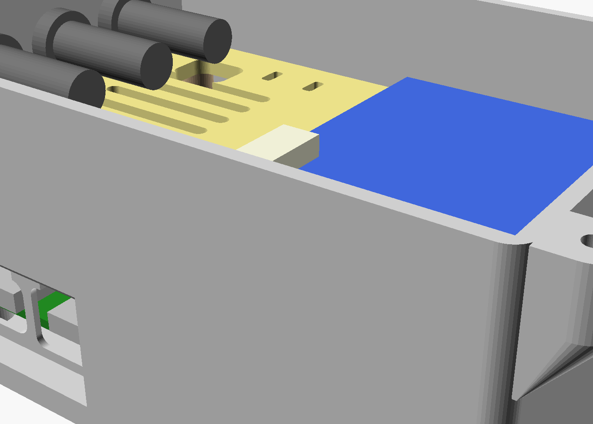
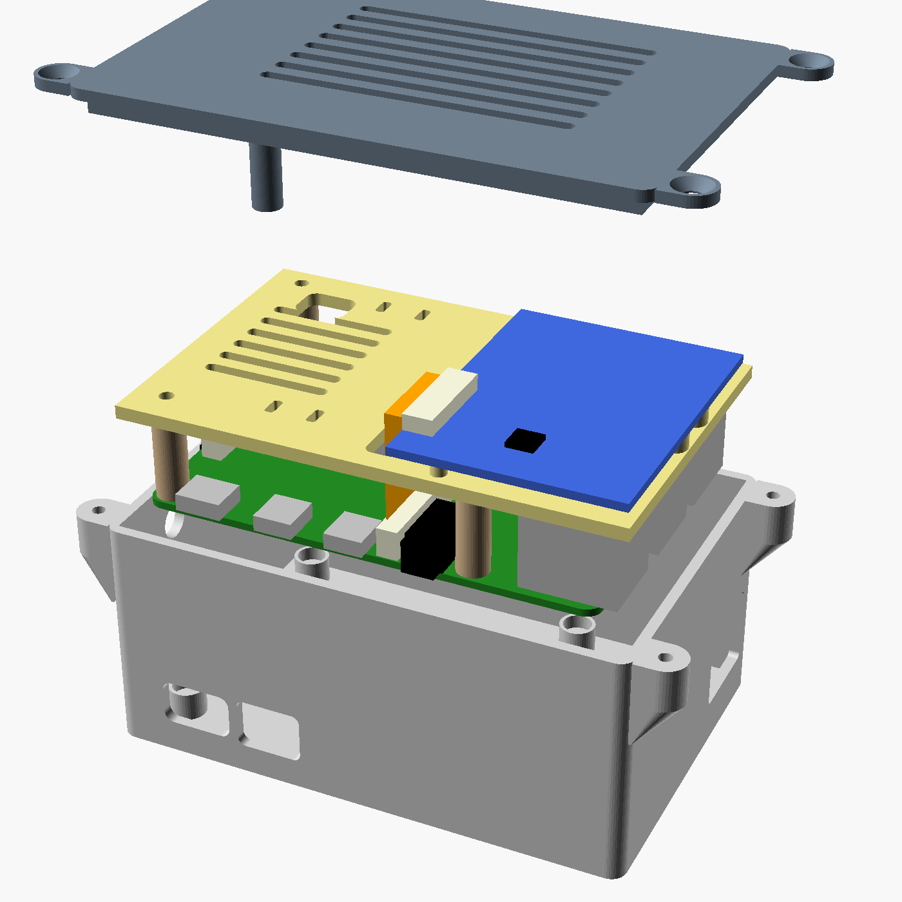

# Корпус SPRUT-M + Raspberry Pi 4 для 3D-печати

Компактный корпус «этажеркой»: внизу Raspberry Pi 4, над ней на печатных стойках пластина с платой SPRUT-M (rev C, целая,
42 × 55, буфер не отломан). Питание Pi — USB-C, видео наружу — по LAN (страница `http://169.254.10.1/`) и с
micro-HDMI0. На левой стенке три гнезда 3,5 мм на 4 контакта: **IN** (камера / приёмник) и аналоговые выходы буфера
**TV** и **GX16** (без задержки).

Габарит с крышкой **96,1 × 65,5 × 48 мм** (с ушками крышки по бокам — 112,1 мм в ширину).
Размеры Raspberry Pi 4B — из официальных файлов Raspberry Pi: контуры всех деталей из чертежа DXF (RP-008342-DS),
высоты разъёмов из механического чертежа (RP-008343-DS). Каждое окно стоит по центру своего разъёма: зазоры
USB-C 2,5 / 2,7 мм, micro-HDMI 2,7 / 3,3 мм (под литой корпус штекера), LAN 0,6 мм с каждой стороны (без fuzzy skin;
с ним на 0,3 мм меньше).

**Разъёмы выходят наружу до упора.** Плата SPRUT-M стоит над Pi так, что её правый край совпадает с передом LAN
(x 88,0): разъём J1 на её левом краю стоит прямо над щелью CSI, шлейф идёт от него вертикально вниз вдоль края платы.
Поэтому правая стенка стоит вплотную к LAN. Спереди плата выступает за Pi на 3,5 мм (так её разъём J1 стоит напротив
CSI), стенка стоит за ней. На уровне Pi вместо стенки — тонкая рамка вплотную к краю платы Pi (0,6 мм), а снаружи
перед ней ниша со скошенным потолком. Разъёмы проходят **сквозь рамку** в прорезях, открытых вверх (модуль опускается
сверху): **LAN торчит из рамки на 1,2 мм, его перед всего в 2,6 мм от наружной поверхности**. USB-C и micro-HDMI стоят
вровень с рамкой (их выступ за край Pi всего 1,25–1,4 мм, дальше рамку не придвинуть — край платы Pi должен пройти
мимо неё). Окна вокруг USB-C и HDMI шире разъёмов, литой корпус штекера заходит в них, и штекер вставляется до конца.
**microSD**: под картой убраны стенка и кусок дна — карту можно ухватить сбоку и снизу.
Весь крепёж — со склада «Закупка» (см. ниже).

 

## Файлы

| Файл | Что это |
|---|---|
| `sprutm-pi4-case.scad` | параметрическая модель OpenSCAD (все размеры — переменные в начале файла) |
| `stl/sprutm-fittest.stl` | **пробная деталь**: низ корпуса до уровня пластины — дно, бобышки и все окна под Pi. Печатается быстро, на ней проверяют посадку Pi до печати всего корпуса |
| `stl/sprutm-base.stl` | корпус |
| `stl/sprutm-lid.stl` | крышка (уже перевёрнута для печати) |
| `stl/sprutm-plate.stl` | пластина под плату SPRUT-M |
| `stl/sprutm-standoff.stl` | стойка 17 мм между Pi и пластиной — **напечатать 4 шт.** |
| `stl/sprutm-labels.stl` | белые надписи IN / TV / GX16 — вкладыш в гравировку на левой стенке (в тех же координатах, что и корпус) |
| `img/` | картинки: сборка, разобранный вид, стенки корпуса |

Пересобрать STL после правки размеров:
`openscad -D 'part="base"' -o stl/sprutm-base.stl sprutm-pi4-case.scad` (части: `base`, `lid`, `plate`, `standoff`, `labels`;
`assembly`, `exploded`, `section` — картинки для проверки; `chk1`…`chk10` — проверки, что детали не пересекаются и что модуль проходит в корпус сверху).

## Печать

PETG или PLA, слой 0,2 мм, 3 периметра, заполнение 20 %. **Поддержки не нужны**: корпус — открытой стороной вверх,
крышка — как лежит в STL (лицом на стол), пластина — плоской стороной на стол. Окна в стенках печатаются мостами,
бобышки и полочки на стенках — с конусом 45°.

**Fuzzy skin («шершавая» поверхность)** — модель уже под неё рассчитана (`fuzzy = 0.3` в начале `.scad`):

* в слайсере (Orca / Bambu Studio / Prusa): Fuzzy skin — **только внешний контур** («Contour» / «Outer walls»),
  толщина **0,3 мм**, шаг точек 0,8 мм;
* включать для **корпуса и крышки**; **пластину — без** fuzzy skin (она внутри, ей нужна точная посадка);
* все вырезы в стенках (USB-C, HDMI, LAN, microSD, гнёзда, вентиляция) уже сделаны **на 0,6 мм больше** — шершавость
  съедает по 0,3 мм с каждой стороны, и после печати они выходят в номинал; зазор бортика крышки и пластины тоже
  увеличен на 0,3 мм;
* печать без fuzzy skin: поставьте `fuzzy = 0` и пересоберите STL — иначе вырезы будут на 0,6 мм свободнее
  (собираться всё равно будет, просто чуть больше люфт крышки).

**Белые надписи** (IN / TV / GX16 под гнёздами, буквы 5 мм, гравировка 1 мм):

* **Принтер с несколькими пластиками** (AMS, CFS, MMU): загрузите `sprutm-base.stl` и `sprutm-labels.stl` **одним
  объектом** (Orca / Bambu Studio спросят «загрузить как один объект из нескольких частей?» — да; координаты у файлов
  общие, надписи сами встанут в гравировку). Корпусу — основной цвет, надписям — белый; для части с надписями fuzzy
  skin **выключите** (в настройках этой части), чтобы края букв были ровными.
* **Обычный принтер**: печатайте только корпус, а гравировку залейте белой краской (маркер-краска, акрил), лишнее
  сотрите с поверхности, пока не высохло.

**Сначала — пробная деталь** `sprutm-fittest.stl` (с теми же настройками, что и корпус). Прикрутите к Pi 4 стойки (винты
снизу), опустите Pi в пробную деталь: головки винтов должны сесть в гнёзда бобышек, Pi — лечь на бобышки ровно,
USB-C, HDMI и LAN — по центру своих окон (по ширине и по высоте), microSD — напротив щели. Вставьте штекеры USB-C,
HDMI и LAN до упора. Только если всё так — печатайте корпус целиком.

## Что нужно (крепёж — со склада «Закупка», остатки на 19.11)

| Деталь | Нужно | На складе | Куда |
|---|---|---|---|
| Винт M2.5 × 8 | 11 | 100 | 4 — Pi к стойкам (снизу), 4 — пластина к стойкам (сверху), 3 — плата SPRUT-M к пластине |
| Винт M3 × 10 с потайной головкой (DIN 965) | 4 | 300 | крышка — в ушки снаружи корпуса |
| Гнездо 3.5 мм (AUX) панельное с гайкой (тип PJ-392) | 3 | 4 | IN, TV, GX16; отверстие 6,2 мм |
| Радиатор алюминиевый 25 × 25 × 10 мм | 1 | 50 | на процессор Pi (над ним 17 мм до пластины) |
| Кабель 4-жильный экранированный | ≈ 30 см | 200 м | видео внутри корпуса: одна жила — сигнал, экран — земля (короткие отрезки, вместо тонкого коаксиала) |
| Шлейф FFC 15 конт., шаг 1,0 мм, 50 мм, **«тип B»** (контакты на концах с разных сторон) | 1 | **нет** | от J1 платы к разъёму CAMERA Pi (см. сборку) |
| 2 провода с гнездом Dupont | 2 | **нет** | питание буфера с GPIO Pi: pin 2 (+5 В), pin 6 (GND) |
| Пара разъёмов JST-SM 2 конт. с проводами (папа + мама) | 4 | **нет** | разъём посередине каждого соединения: питание J4 и видео J5, J6, J7 — плата становится съёмной |
| Стяжки 2,5 мм | 2 | — | закрепить разъёмы на пластине (прорези слева) |

Все винты вкручиваются прямо в пластик и сами нарезают резьбу (отверстия в модели — под это).
**Плату SPRUT-M подготовить:** рассверлить отверстия H2, H3, H4 с 2,2 до 2,6 мм (они без металлизации, вокруг 5 мм
свободно). H1 не нужен — под ним упор на пластине.

## Идея сборки: всё паяется на столе, в корпусе только винты и разъёмы

* **Гнёзда ставятся изнутри**: круглый фланец — внутри у стенки, гайка — снаружи. Поэтому гнездо можно припаять
  к кабелю заранее, а потом просунуть резьбой в отверстие изнутри и затянуть гайку снаружи.
* **Каждое соединение — с разъёмом посередине** (JST-SM 2 конт.): к площадкам J4, J5, J6, J7 платы припаиваются
  короткие хвосты 5–8 см с одной половинкой разъёма, к гнёздам и к проводам с GPIO — с ответной. Плата снимается
  целиком: отключить 4 разъёма и шлейф, открутить 3 винта. Разъёмы ложатся на свободную левую часть пластины, их
  прихватывают стяжками через прорези.
* Угловые штырьки прямо на плату не подходят: у J4, J6, J7 разъём Dupont лёг бы на детали платы (он висит на высоте
  0–2,5 мм над ней), а в другую сторону упёрся бы в правую стенку (от края платы до неё 3 мм).

## Сборка

Вся электроника собирается **на столе в один модуль** и потом целиком опускается в корпус сверху. Внутри стенок над
Pi ничего не нависает: между разъёмами Pi и стенками всего 1,5–3,5 мм, бобышкам и полкам там места нет (это проверено
в модели — проверка `chk10`: модуль проходит сверху до места, ни за что не цепляясь).

**На столе:**

1. **Плата SPRUT-M**: рассверлить H2, H3, H4; припаять хвосты с разъёмами к J4 (+5V, GND), J5 (вход), J6 (TV),
   J7 (GX16) — сигнал / красный на квадратную площадку, земля / чёрный на круглую.
2. **Гнёзда**: припаять хвосты с ответными разъёмами. Распиновка 4-контактных кабелей AV 3,5 мм у разных
   производителей **разная** — прозвоните тестером свой кабель: какой контакт гнезда идёт на жёлтый (видео) штекер,
   какой — на землю. Два провода Dupont для GPIO — тоже с ответным разъёмом на другом конце.
3. **Pi 4 + стойки**: поставить 4 стойки на отверстия Pi сверху и прикрутить **снизу** винтами M2.5 × 8 (через
   отверстие Pi в стойку). Радиатор — на процессор. Шлейф — в разъём CAMERA, провода Dupont — на GPIO: pin 2 (+5 В)
   и pin 6 (GND).
4. **Пластина** — на стойки, 4 винта M2.5 × 8 сверху. Шлейф пропустить в щель пластины, провода питания — в окно
   слева сзади. Один винт пластины окажется под платой — поэтому пластина ставится **до** платы.
5. **Плата SPRUT-M** — на пластину, 3 винта M2.5 × 8; шлейф — в J1. J1 стоит рядом с разъёмом камеры Pi и
   параллельно ему: шлейф выходит из J1 влево и сразу загибается вниз. У J1 шлейф входит **контактами вниз, к плате**,
   а у разъёма камеры Pi 4 контакты смотрят **в сторону HDMI** — при таком изгибе нужен шлейф **«тип B»**. Перед
   покупкой сверьте с вашим Pi: если ошибиться, ничего не сгорит, просто не будет видео.
6. Разъём питания J4 — соединить с проводами от GPIO. Модуль готов — можно включить и проверить видео ещё на столе.

**В корпус:**

7. **Модуль** — опустить в корпус сверху ровно: головки винтов под Pi садятся в гнёзда бобышек на дне, USB-C и HDMI
   встают напротив окон спереди, LAN — справа, microSD — у щели слева (карту удобнее вставить уже потом, через щель).
8. **Гнёзда** — изнутри в отверстия левой стенки (фланец внутри), гайки снаружи; разъёмы соединить (J5 → IN,
   J6 → TV, J7 → GX16), уложить слева на пластину и прихватить стяжками через прорези.
9. **Крышка** — два столбика с её нижней стороны прижимают пластину (модуль не болтается), 4 винта M3 × 10 в ушки
   снаружи корпуса.

Разборка — в обратном порядке: открутить крышку, отключить 3 видеоразъёма, вынуть модуль целиком.

Питание — USB-C Pi (блок 5 В 3 А): декодер питается от Pi по шлейфу, буфер — от GPIO через J4.
Видео: кабель LAN → `http://169.254.10.1/` (см. [docs/usb-grabber.md](../docs/usb-grabber.md)); HDMI — с micro-HDMI0.
